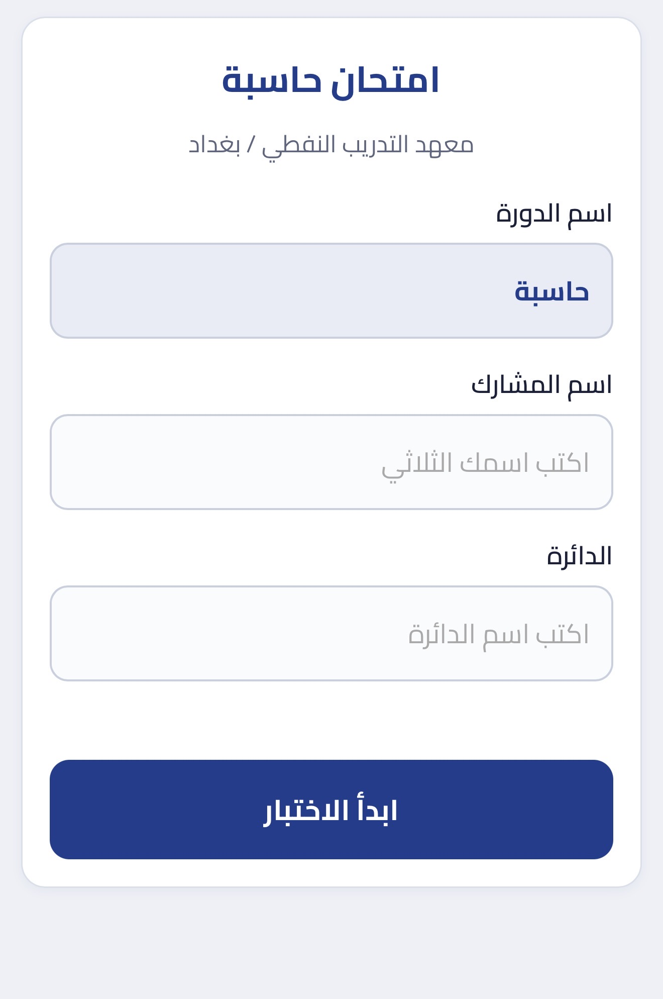

# نظام الاختبارات الإلكترونية للدورات الحضورية
### نموذج تطبيقي طُوّر بمساعدة الذكاء الاصطناعي

**إعداد وتصميم: إيمان عادل جاسم / رئيس مبرمجين اقدم اول**  
**معهد التدريب النفطي / بغداد**

🔗 [فتح نموذج امتحان الحاسبة](https://computerexam1.netlify.app)  
📄 [عرض وتحميل ملف رابط الامتحان ورمز QR](exam-link-qr.pdf)

## نبذة عن المشروع

نموذج مبسط للاختبارات النظرية الإلكترونية، صممته بمساعدة أدوات الذكاء الاصطناعي لتسهيل إجراء الامتحانات في الدورات الحضورية. وقد طبّقته عمليًا باستخدام الهواتف المحمولة للمشاركين، دون الحاجة إلى توفير حواسيب أو أجهزة لوحية.

يتيح النظام أداء الاختبار عن طريق الباركود ، وتصحيح الإجابات آليًا، وعرض النتيجة مباشرة، ثم إرسالها إلى محاضر الدورة وحفظها في **Google Sheets**، بما يسهم في تقليل الاعتماد على الأوراق واختصار وقت التصحيح وجمع الدرجات.

## أبرز المميزات

- **دخول مبسط دون بريد إلكتروني:** يكتفي المشارك بإدخال اسمه ودائرته أو شركته، مع ظهور اسم الدورة أعلى الواجهة.
- **التحقق من البيانات:** لا يمكن بدء الاختبار قبل إدخال اسم المشارك والجهة التي ينتمي إليها.
- **التحقق من اكتمال الإجابات:** لا تُعرض النتيجة قبل الإجابة عن جميع الأسئلة، ويُنقل المشارك تلقائيًا إلى الأسئلة غير المجاب عنها لاستكمالها.
- **تصحيح آلي ونتيجة فورية:** تظهر النتيجة للمشارك بعد إكمال الإجابات والضغط على زر «عرض النتيجة».
- **إرسال النتائج إلى المحاضر:** عند الضغط على زر «إرسال النتيجة»، تُسجّل النتيجة في Google Sheets ليتمكن المحاضر من متابعتها.
- **ضبط محاولة الاختبار:** يتضمن النموذج آلية لمنع إعادة المحاولة عند مغادرة شاشة الامتحان، وفق آلية الضبط المطبقة فيه.
- **الاستخدام عبر الهاتف المحمول:** يتيح للمشاركين أداء الاختبار بأجهزتهم الشخصية أثناء الدورة الحضورية.

## خطوات الاستخدام

1. فتح رابط الامتحان والتأكد من اسم الدورة الظاهر.
2. إدخال اسم المشارك والدائرة أو الشركة.
3. الضغط على «ابدأ الاختبار».
4. الإجابة عن جميع الأسئلة واستكمال أي إجابات ناقصة.
5. الضغط على «عرض النتيجة» للاطلاع على الدرجة.
6. الضغط على «إرسال النتيجة» لإرسالها إلى محاضر الدورة.

## صورة واجهة الامتحان

تُظهر الصورة واجهة الدخول إلى امتحان الحاسبة في معهد التدريب النفطي / بغداد، وتتضمن اسم الدورة وحقلي اسم المشارك والدائرة، وزر «ابدأ الاختبار». صُمّمت الواجهة لتسهيل بدء الامتحان عبر الهاتف المحمول دون الحاجة إلى بريد إلكتروني.

  

## ملف رابط الامتحان ورمز الاستجابة السريعة (QR)

أُرفق ملف PDF الخاص برابط الامتحان ورمز QR، لتسهيل مشاركته مع المشاركين أثناء الدورة الحضورية والوصول إلى الامتحان باستخدام هواتفهم المحمولة.

📄 **[عرض وتحميل ملف رابط الامتحان ورمز QR](exam-link-qr.pdf)**

## القيمة العملية

يمثل المشروع تطبيقًا عمليًا لتوظيف الذكاء الاصطناعي في تطوير أدوات التدريب والتقييم، وتبسيط إجراءات الامتحانات الحضورية، وتقليل الجهد الإداري واستهلاك الورق، وتسهيل توثيق النتائج إلكترونيًا.

**دور الذكاء الاصطناعي:** المساعدة في تصميم النموذج وتطويره، بينما يعتمد تصحيح الاختبار على الإجابات الصحيحة المحددة مسبقًا.

## محتويات المستودع

| الملف | الوصف |
| --- | --- |
| [README.md](README.md) | التعريف بالمشروع ومميزاته وخطوات استخدامه. |
| [exam-interface.jpeg](exam-interface.jpeg) | صورة واجهة الدخول إلى الامتحان. |
| [exam-link-qr.pdf](exam-link-qr.pdf) | ملف رابط الامتحان ورمز QR المخصص للمشاركة. |

هذا الامتحان مثال مبسط من نماذج الاختبارات النظرية التي صممتها وطبقتها في دوراتي الحضورية.
